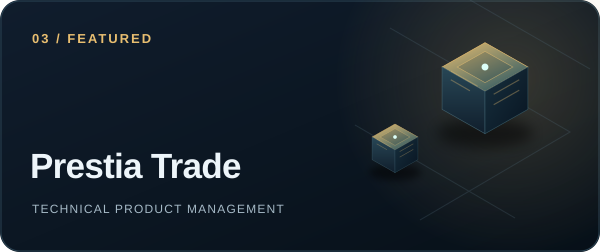

<strong>Coquitlam, British Columbia, Canada</strong> · He/Him 
<a href="https://www.linkedin.com/in/kianisafa/">LinkedIn</a> · <a href="https://safakiani.com/">Personal website</a> · <a href="#connect">Work with me</a>

<a href="#featured">Featured</a> · <a href="#about">About</a> · <a href="#experience">Experience</a> · <a href="#projects">Projects</a> · <a href="#skills">Skills</a> · <a href="#education">Education</a> · <a href="#licenses-and-certifications">Credentials</a>

## Featured

<table>
<tr>
<td width="50%" valign="top">

Designed, developed, and launched the Danesh Production website through After Landing Services Inc. Manage hosting, content, SEO, and ongoing technical support, with Google Workspace and Google Voice supporting company communications.

</td>
<td width="50%" valign="top">

Designed and developed Kian Teb's online store. Lead ongoing content, SEO, payment integrations, order workflows, and technical operations remotely from Canada, coordinating digital processes with the fulfilment team in Iran.

</td>
</tr>
<tr>
<td width="50%" valign="top">

Guide product requirements, website structure, user journeys, and technical delivery for Prestia Trade's public website. Connect business needs with practical digital improvements, with a focus on usability, reliability, and information quality.

</td>
<td width="50%" valign="top">

Explore my public GitHub profile, including publicly available code, projects, and development work.

</td>
</tr>
</table>

## About

I help businesses connect websites, applications, and day-to-day operations into practical, manageable systems. My focus is systems integration, workflow design, and AI-assisted automation, with close attention to information accuracy and organization.

Based in Metro Vancouver, I founded After Landing Services Inc. and deliver website development and continuing digital support for clients including Danesh Production, Drago Pharma, and Rivara Host. My work spans server setup, development, content, SEO, CRM workflows, and business communication systems. At Danesh, I also developed a shift management application for team scheduling and payment tracking.

I lead Kian Teb's digital and e-commerce operations remotely from Canada and work as Technical Product Manager at Prestia Trade, translating business needs into product requirements, workflow architecture, and coordinated delivery.

Across these projects, I am developing AI integrations and automation to reduce repetitive work and support clear, consistent information flows.

I welcome contracts and long-term business collaborations in systems integration, workflow automation, and digital operations, as well as relevant product and systems roles.

**Top skills:** Systems Integration · Workflow Automation · Product Management · Process Optimization · Web Development

## Experience

Open each role for responsibilities and supporting documents.

<strong>Prestia Trade LLC | Technical Product Manager (Digital Systems &amp; Workflow Architecture) | October 2026 to Present</strong>

**Prestia Trade LLC** · October 2026 to Present  
Remote

Manage digital product requirements, workflow architecture, and technical delivery for Prestia Trade, connecting business needs with practical digital products and services.

**Key contributions:**

- Translate business, customer, and market needs into requirements, roadmaps, backlog priorities, and acceptance criteria.
- Design workflows and reusable sub-workflows, including triggers, inputs, decisions, states, outputs, and error recovery.
- Coordinate integrations across websites, portals, CRM, communications, data, automation, and APIs.
- Work on AI integrations for Prestia Trade websites and digital workflows as part of ongoing product development.
- Align developers and technical partners on dependencies, implementation, testing, acceptance, and staged releases.
- Turn feedback from users and business teams into product capabilities and improvements.
- Review operational performance, coordinate versioned changes, and maintain support and maintenance documentation.

Employment type: Freelance.

<strong>Danesh Production | Technical Systems Specialist | September 2024 to Present</strong>

**Danesh Production** · September 2024 to Present  
Metro Vancouver Regional District, BC

Develop and manage digital systems and operational workflows at Danesh Production, connecting management, employees, and live event teams. My work combines hands-on website and application development, business systems administration, team coordination, and on-site technical production.

**Key contributions:**

- Designed, developed, and launched the company website, including server and hosting setup, with ongoing responsibility for content, SEO, and technical operations.
- Set up and administer Google Workspace for company email and Google Voice for business phone services.
- Developed a shift management application to present team schedules clearly and track staff payments.
- Work on CRM systems and operational workflows to organize information, responsibilities, and follow-up.
- Coordinate communication and day-to-day operational needs between management and employees.
- Operate lighting, sound, and LED wall systems on selected live event productions.
- Work on AI integrations and workflow automation across the website and related digital systems.

Employment type: Freelance.

Location and work setting: Greater Vancouver, British Columbia, Canada (Hybrid).

<strong>After Landing Services Inc. | Founder &amp; President | December 2022 to Present</strong>

**After Landing Services Inc.** · December 2022 to Present  
Vancouver, BC

Founded After Landing Services Inc. to provide business support, digital services, and event coordination in Canada.

Manage the company's operations, client relationships, and service delivery.

**Key contributions:**

- Develop the company's operating structure, service workflows, and communication systems.
- Manage client website development, maintenance, and ongoing support plans, including Danesh Production, Drago Pharma, and Rivara Host.
- Coordinate cultural programs, concerts, and community events.
- Provide digital consulting, branding support, and workflow organization for clients.
- Oversee business development, client communication, and day-to-day service coordination.

Employment type: Self-employed.

Location and work setting: Vancouver, British Columbia, Canada (On-site).

<strong>Kiantebmed | Digital Transformation &amp; E-commerce Lead | January 2015 to Present</strong>

**Kiantebmed** · January 2015 to Present  
Canada (Remote)

Lead digital transformation and e-commerce operations for Kian Teb, a medical equipment business in Iran. I designed and developed the company's online store and now manage its website, online sales systems, and digital marketing activities remotely from Canada.

**Key contributions:**

- Design, develop, and maintain the website and customer journey, from product discovery and landing pages to checkout and order tracking.
- Create website and product content and coordinate the digital execution of product launches.
- Manage SEO and ongoing website improvements to support search visibility and the online shopping experience.
- Manage online payment integrations and workflows for receiving and processing customer orders.
- Connect online sales with order fulfilment, coordinating digital processes with the team in Iran responsible for packaging and dispatch.
- Maintain connected digital systems and improve the reliability of day-to-day online operations.
- Work on AI integrations and process automation to support the company's ongoing digital development.

<strong>Prestia Trade LLC | Technical Systems Specialist | February 2024 to September 2026</strong>

**Prestia Trade LLC** · February 2024 to September 2026  
Remote

Managed technical systems, website infrastructure, and workflow coordination for daily business operations at Prestia Trade LLC.

**Key contributions:**

- Designed, maintained, and supported company website systems and technical environments.
- Managed communication infrastructure and supported operational reliability.
- Built workflow systems to improve task visibility and coordination.
- Organized CRM structures for client tracking and internal processes.
- Coordinated scheduling and operational workflows across business activities.
- Developed structured data and media systems to improve access to information.

Employment type: Freelance.

<strong>Pacificana Development | Commercial Construction Apprentice | September 2021 to May 2026</strong>

**Pacificana Development** · September 2021 to May 2026  
Vancouver, BC

Completed apprenticeship training within a commercial general contracting environment, gaining hands-on exposure to large-scale construction operations and professional project environments across Vancouver.

Worked alongside experienced teams on commercial construction projects for major retail brands including Home Depot, RONA, and Sephora, while developing practical experience in communication, teamwork, workflow coordination, site operations, and professional construction standards.

**Key contributions:**

- Supported day-to-day activities across active commercial construction projects
- Assisted teams with operational support and on-site coordination tasks
- Gained hands-on exposure to workflow organization, project execution, and construction site operations
- Contributed within fast-paced commercial project environments involving large retail and corporate brands
- Developed practical experience in teamwork, communication, operational discipline, and professional work environments Focused on learning professional standards, operational structure, and real-world project coordination within commercial construction environments.

Employment type: Apprenticeship.

Location and work setting: Vancouver, British Columbia, Canada (On-site).

<strong>Daloun | Marketing Team | October 2024 to December 2024</strong>

**Daloun** · October 2024 to December 2024  
Vancouver, BC

Worked within the marketing team at Daloun, supporting lead organization, client outreach, and sales opportunity coordination for custom rug and interior design projects.

My role focused on managing lead databases, organizing communication workflows, supporting email outreach, and identifying potential business opportunities across different client segments.

**Key contributions:**

- Organized and maintained lead databases and client information systems
- Managed outreach and follow-up communication through email coordination
- Assisted in identifying potential sales opportunities and business prospects
- Supported workflow organization and internal coordination across marketing activities
- Worked with client information, communication tracking, and operational follow-ups
- Gained practical experience in lead management, communication workflows, and sales coordination Focused on maintaining organized communication, structured lead management, and efficient operational support within a fast-paced business environment.

Employment type: Contract Part-time.

Location and work setting: Vancouver, British Columbia, Canada (On-site).

<strong>Borna Kelishadi | Professional Photographer | October 2019 to September 2021</strong>

**Borna Kelishadi** · October 2019 to September 2021  
Isfahan, Isfahan Province, Iran (On-site)

Worked on commercial photography projects with Borna Studio and Borna Klishadi in Isfahan.

**Key contributions:**

- Photographed projects for industrial, food production, postal, and jewellery businesses.
- Adapted photographic approaches to different products, locations, and client briefs.
- Collaborated with the studio team to plan shoots and produce visual material aligned with client requirements.

Employment type: Freelance.

<strong>SINA Hospital &amp; Heart Center | Photography &amp; Videography Contributor | October 2019 to September 2021</strong>

**SINA Hospital & Heart Center** · October 2019 to September 2021  
Isfahan, Isfahan Province, Iran (On-site)

Contributed photography and video documentation for Sina Hospital & Heart Center in Isfahan as part of my internship and hospital responsibilities.

**Key contributions:**

- Provided photography for the hospital's visual documentation work.
- Contributed filming and video documentation as part of the same work.

Recognition: Received an official letter of appreciation dated April 12, 2022, acknowledging my photography and filming contributions.

Employment type: Internship.

[Certificate and recognition letter (English and Persian)](documents/sina-photography-videography.pdf)

<strong>SINA Hospital &amp; Heart Center | Management &amp; Business Committee Participant | October 2019 to September 2021</strong>

**SINA Hospital & Heart Center** · October 2019 to September 2021  
Isfahan, Isfahan Province, Iran (On-site)

Participated in the Management and Business Committee at Sina Hospital & Heart Center in Isfahan over a two-year period.

**Key contributions:**

- Took an active part in the committee's management and business activities.
- Gained exposure to hospital administration, business operations, and coordination across departments.

Recognition: Received an official hospital certificate dated April 12, 2022, confirming my active participation and the committee secretary's satisfaction with my contribution.

Employment type: Internship.

[Certificate and recognition letter (English and Persian)](documents/sina-management-business-committee.pdf)

<strong>SINA Hospital &amp; Heart Center | Information Technology Intern | October 2019 to September 2021</strong>

**SINA Hospital & Heart Center** · October 2019 to September 2021  
Isfahan, Isfahan Province, Iran (On-site)

Completed a two-year internship in the Information Technology Department at Sina Hospital & Heart Center in Isfahan, supporting technology operations in a healthcare environment.

**Key contributions:**

- Assisted the IT team with computer systems, network equipment, and hospital software support.
- Supported troubleshooting and day-to-day technical tasks.
- Worked with departmental staff to complete assigned internship duties.

Recognition: Received an official hospital certificate dated April 12, 2022, confirming completion of the internship and the department's satisfaction with my work.

Employment type: Internship.

[Certificate and recognition letter (English and Persian)](documents/sina-it-internship.pdf)

<strong>SINA Hospital &amp; Heart Center | Supply Chain Intern | October 2019 to September 2021</strong>

**SINA Hospital & Heart Center** · October 2019 to September 2021  
Isfahan, Isfahan Province, Iran (On-site)

Completed a two-year internship in the Supply Chain Department at Sina Hospital & Heart Center in Isfahan, supporting daily supply operations in a healthcare setting.

**Key contributions:**

- Assisted with procurement, inventory, and supply coordination activities.
- Supported departmental staff with assigned operational tasks.
- Gained practical experience in the coordination of hospital supplies and resources.

Recognition: Received an official hospital certificate dated April 12, 2022, recognizing satisfactory completion of my internship duties.

Employment type: Internship.

[Certificate and recognition letter (English and Persian)](documents/sina-supply-chain-internship.pdf)

## Projects

Seven project entries from my LinkedIn portfolio. Prestia Trade appears separately in Featured and Experience.

<strong>Kian Teb | E-commerce Development &amp; Digital Operations</strong>

Jan 2015 to Present Designed, developed, and launched Kian Teb's e-commerce website. Continue to manage its content, online sales features, and digital operations remotely from Canada.

**Key contributions:**

- Configured the server and hosting environment and deployed the website.
- Customized the website theme, layout, and functionality, including product pages, landing pages, checkout, and order tracking.
- Create website and product content and prepare digital materials for product launches.
- Manage SEO and ongoing improvements to search visibility and the shopping experience.
- Maintain online payment integrations and order workflows, coordinating with the team in Iran responsible for packaging and dispatch.
- Handle ongoing website updates, technical support, and operational improvements.
- Work on AI integrations and further workflow automation as part of ongoing platform development.

Website: https://kiantebmed.com/

Associated with Kiantebmed

<strong>Disruptive Technologists | Google Ad Grants College Project</strong>

Feb 2024 to Apr 2024 Completed a client project for Disruptive Technologists® Inc. as part of the Marketing Technology Diploma at Vancouver Community College (VCC), from February to April 2024.

**Key contributions:**

- Served as student project manager and team lead for Google Ad Grants work.
- Coordinated campaign strategy, team activities, and stakeholder communication.
- Reviewed campaign performance to identify opportunities for improvement.

Context: Academic project completed through VCC coursework.

Associated with Vancouver Community College (VCC)

<strong>IGWDC | Azar Oil Field Photography &amp; Documentation</strong>

Jul 2020 to Jul 2020 Contributed as Second Photographer to the documentation of the Azar Oil Field pipelines and oil installation project in Mehran, Ilam Province, Iran.

**Key contributions:**

- Worked with the documentation team to photograph the project and its facilities.
- Contributed visual documentation in an industrial environment.

Recognition: Received an official letter of appreciation from Iranian Gas & Water Developments Co. (IGWDC), dated July 21, 2020, recognizing my cooperation, photography and documentation work, and professional and creative use of equipment.

[View award letter (English and Persian)](documents/igwdc-appreciation.pdf)

<strong>Kian Teb | Store &amp; Product Photography</strong>

Oct 2018 to Oct 2018 Created photography and video documentation for Kian Teb's medical equipment store in Isfahan, Iran.

**Key contributions:**

- Photographed the store, its interior, and its medical equipment and products.
- Created visual material presenting the business and its physical store.
- Contributed video documentation as part of the same project.

Store overview video: https://www.youtube.com/watch?v=Wdtdxwq6vWQ

<strong>Danesh Production | Website Development &amp; Digital Operations</strong>

Designed, developed, and launched the Danesh Production website. Manage ongoing content, SEO, and technical operations through After Landing Services Inc. as part of a continuing client service plan.

**Key contributions:**

- Configured the server and hosting environment and deployed the website.
- Customized the website theme, layout, and functionality to support the company's brand and services.
- Build and maintain service pages, portfolio content, and landing pages.
- Manage website content, SEO, and improvements to the visitor experience.
- Set up and administer Google Workspace for company email and Google Voice for business phone services.
- Handle website updates, technical maintenance, and ongoing client support.
- Work on AI integrations and workflow automation for the website and related digital operations.

Website: https://daneshproduction.ca/

Associated with After Landing Services Inc.

<strong>Drago Pharma | Website Development &amp; Digital Operations</strong>

Designed, developed, and launched the Drago Pharma website. Manage ongoing content, SEO, and technical operations through After Landing Services Inc. as part of a continuing client service plan.

**Key contributions:**

- Configured the server and hosting environment and deployed the website.
- Customized the website theme, layout, and functionality for the business.
- Build and maintain product information, website content, and landing pages.
- Manage SEO and improvements to site navigation and the visitor experience.
- Handle website updates, technical maintenance, and ongoing client support.
- Work on AI integrations and workflow automation for the website and related digital operations.

Website: https://dragopharma.com/

Associated with After Landing Services Inc.

<strong>Rivara Host | Website Development &amp; Digital Operations</strong>

Designed, developed, and launched the Rivara Host website for its event, catering, and hospitality services. Manage ongoing digital operations through After Landing Services Inc. as part of a continuing client service plan.

**Key contributions:**

- Configured the server and hosting environment and deployed the website.
- Customized the website theme, layout, and functionality to present the company's services.
- Build and maintain service content and landing pages, and manage SEO and the visitor experience.
- Set up Google Workspace to support company email and business communication.
- Handle website updates, technical maintenance, and ongoing client support.
- Work on AI integrations and workflow automation for the website and related digital operations.

Website: https://rivarahost.ca/

Associated with After Landing Services Inc.

## Skills

**Systems Integration · Workflow Automation · Product Management · Process Optimization · Web Development**

<strong>Explore all 48 skills</strong>

**Integration, product and delivery**

Systems Integration, Workflow Automation, Product Management, Process Optimization, Web Development, Project Management, Workflow Management, Business Requirements, Strategic Planning.

**Web, commerce and analytics**

Content Creation, Search Engine Optimization (SEO), E-Commerce, Google Search Console, Website Administration, Content Management Systems (CMS), Google Ads, Data Analysis, Google Analytics, Data Analysis and Forecasting, WordPress.

**IT and business systems**

Google Workspace Administration, Information Technology Infrastructure, Hospital Software Proficiency, Network Management, System Maintenance & Troubleshooting, Office 365 Administration, IT Management.

**Creative and production**

Lighting & Visual Operation, Adobe Photoshop, Photography, Portrait Photography, Videography, Adobe Premiere Pro.

**Operations and collaboration**

Customer Experience, Confidentiality, Shareholder Communications, Logistics Coordination, Accuracy, Time Management, Communication, Negotiation, Analytical Skills, Teamwork, Team Leadership.

**Productivity tools**

Microsoft Word, Microsoft Excel, Microsoft Outlook, Microsoft PowerPoint.

[Skill associations and endorsements on LinkedIn](https://www.linkedin.com/in/kianisafa/details/skills/)

## Education

<strong>Vancouver Community College (VCC) | Marketing Technology Diploma | January 2023 to December 2024</strong>

Completed the two-year, full-time Marketing Technology Diploma at Vancouver Community College on December 16, 2024.

**Key areas of study:**

- CRM administration, marketing automation, and data analytics.
- Digital advertising, e-commerce, and marketing strategy.
- Business analysis, systems design, and software project management.

Applied learning: Served as student project manager and team lead on a Google Ad Grants project for Disruptive Technologists® Inc. as part of VCC coursework.

[View diploma](documents/vcc-marketing-technology-diploma.pdf)

<strong>ILSC Education Group | University Pathway Program | September 2021 to September 2022</strong>

Grade: ILSC Advanced 2 (A2)

Activities and societies: Student Ambassador Program (volunteer).

Completed 49 weeks of English language study and the University Pathway Program from September 27, 2021, to September 9, 2022.

Completed at ILSC Advanced 2 (A2), with a focus on academic English and preparation for further education.

[View completion certificate](documents/ilsc-pathway.pdf)

## Licenses and certifications

17 entries, with issuer and validity dates. Historical certificates retain their original expiry dates.

<strong>Tech Stewardship Practice Program (TSPP) | October 2024</strong>

**Issuer:** Tech Stewardship  
**Issued:** October 2024  
**Credential ID:** 86952494417394

[Verify credential](https://credentials.techstewardship.com/en/verify/86952494417394) · [LinkedIn credential record](https://www.linkedin.com/in/kianisafa/details/certifications/)

<strong>Bronze Medallion | February 2026</strong>

**Issuer:** Lifesaving Society BC & Yukon Branch  
**Issued:** February 2026

Bronze Medallion certificate awarded by the Lifesaving Society, British Columbia and Yukon Branch, on February 16, 2026.

[View certificate](documents/bronze-medallion.pdf) · [LinkedIn credential record](https://www.linkedin.com/in/kianisafa/details/certifications/)

<strong>CancerGuard and Access Life | Continuing Education (1 Hour) | October 2021</strong>

**Issuer:** iA Financial Group (Industrial Alliance)  
**Issued:** October 2021

Certificate confirming 1.0 hour of continuing education completed on October 20, 2021, in Vancouver.

[View certificate](documents/ia-continuing-education.pdf) · [LinkedIn credential record](https://www.linkedin.com/in/kianisafa/details/certifications/)

<strong>Computer Graphics (Skills Certificate) | August 2020</strong>

**Issuer:** Ministry of Culture and Islamic Guidance  
**Issued:** August 2020  
**Credential ID:** 983521411504958360

Official skills certificate issued by the Ministry of Culture and Islamic Guidance in August 2020.

[View certificate](documents/computer-graphics.pdf) · [LinkedIn credential record](https://www.linkedin.com/in/kianisafa/details/certifications/)

<strong>Computer Operation (Skills Certificate) | August 2020</strong>

**Issuer:** Ministry of Culture and Islamic Guidance  
**Issued:** August 2020  
**Credential ID:** 983521411504919760

Official skills certificate issued by the Ministry of Culture and Islamic Guidance in August 2020.

[View certificate](documents/computer-operation.pdf) · [LinkedIn credential record](https://www.linkedin.com/in/kianisafa/details/certifications/)

<strong>Computer Typing (Skills Certificate) | August 2020</strong>

**Issuer:** Ministry of Culture and Islamic Guidance  
**Issued:** August 2020  
**Credential ID:** 983521411504943088

Official skills certificate issued by the Ministry of Culture and Islamic Guidance in August 2020.

[View certificate](documents/computer-typing.pdf) · [LinkedIn credential record](https://www.linkedin.com/in/kianisafa/details/certifications/)

<strong>Colour Graphic Design (Skills Certificate) | August 2020</strong>

**Issuer:** Ministry of Culture and Islamic Guidance  
**Issued:** August 2020  
**Credential ID:** 983521411504939575

Official skills certificate issued by the Ministry of Culture and Islamic Guidance in August 2020.

[View certificate](documents/colour-graphic-design.pdf) · [LinkedIn credential record](https://www.linkedin.com/in/kianisafa/details/certifications/)

<strong>Black and White Graphic Design (Skills Certificate) | September 2020</strong>

**Issuer:** Ministry of Culture and Islamic Guidance  
**Issued:** September 2020  
**Credential ID:** 994021411504926643

Official skills certificate issued by the Ministry of Culture and Islamic Guidance in September 2020.

[View certificate](documents/black-and-white-graphic-design.pdf) · [LinkedIn credential record](https://www.linkedin.com/in/kianisafa/details/certifications/)

<strong>Real Estate Consultancy | 60-Hour Training Attendance Certificate | June 2021</strong>

**Issuer:** Iran Technical & Vocational Training Organization  
**Issued:** June 2021

Certificate confirming attendance at 60 hours of specialized real estate consultancy training, issued by the Technical and Vocational Training Organization, Isfahan Province, Iran. Training held at the Isfahan Real Estate Consultants Union.

[View certificate](documents/real-estate-training.pdf) · [LinkedIn credential record](https://www.linkedin.com/in/kianisafa/details/certifications/)

<strong>Google Ads Search Certification | November 2025</strong>

**Issuer:** Google Digital Academy (Skillshop)  
**Issued:** November 2025  
**Expires:** November 2026  
**Credential ID:** 166402389

[Verify credential](https://skillshop.credential.net/68a30f99-7b33-4412-9d34-3c9b76bbd651) · [LinkedIn credential record](https://www.linkedin.com/in/kianisafa/details/certifications/)

<strong>Inbound Marketing | October 2024</strong>

**Issuer:** HubSpot Academy  
**Issued:** October 2024  
**Expires:** October 2026  
**Credential ID:** 3dd6b43c598b40d6adb3dd11cf29b81f

[Verify credential](https://app.hubspot.com/academy/achievements/sfsyj3gp/en/1/safa-kiani/inbound-marketing) · [View certificate](documents/hubspot-inbound-marketing.pdf) · [LinkedIn credential record](https://www.linkedin.com/in/kianisafa/details/certifications/)

<strong>Content Marketing | October 2024</strong>

**Issuer:** HubSpot Academy  
**Issued:** October 2024  
**Expires:** October 2026  
**Credential ID:** d55f51345bd24c3187628ff77a944871

[Verify credential](https://app.hubspot.com/academy/achievements/8bx79f8s/en/1/safa-kiani/content-marketing) · [View certificate](documents/hubspot-content-marketing.pdf) · [LinkedIn credential record](https://www.linkedin.com/in/kianisafa/details/certifications/)

<strong>Email Marketing | October 2024</strong>

**Issuer:** HubSpot Academy  
**Issued:** October 2024  
**Expires:** October 2026  
**Credential ID:** 362690650bc94b3cab5f567a8d2814ac

[Verify credential](https://app.hubspot.com/academy/achievements/x8y0scbr/en/1/safa-kiani/email-marketing) · [View certificate](documents/hubspot-email-marketing.pdf) · [LinkedIn credential record](https://www.linkedin.com/in/kianisafa/details/certifications/)

<strong>Social Media Marketing | October 2024</strong>

**Issuer:** HubSpot Academy  
**Issued:** October 2024  
**Expires:** October 2026  
**Credential ID:** f790b428108a4a79bc673dc2f807fd07

[Verify credential](https://app.hubspot.com/academy/achievements/sry1n16f/en/1/safa-kiani/social-media-marketing) · [View certificate](documents/hubspot-social-media.pdf) · [LinkedIn credential record](https://www.linkedin.com/in/kianisafa/details/certifications/)

<strong>HubSpot Marketing Hub Software | October 2024 | expired October 2025</strong>

**Issuer:** HubSpot Academy  
**Issued:** October 2024  
**Expires:** October 2025 (expired)  
**Credential ID:** 98cc362be4fd42c0be52dfdb526fcbf2

[Verify credential](https://app.hubspot.com/academy/achievements/mb0nylfm/en/1/safa-kiani/hubspot-marketing-hub-software) · [View certificate](documents/hubspot-marketing-hub.pdf) · [LinkedIn credential record](https://www.linkedin.com/in/kianisafa/details/certifications/)

<strong>Google Ads Search Certification | January 2024 | expired January 2025</strong>

**Issuer:** Google Digital Academy (Skillshop)  
**Issued:** January 2024  
**Expires:** January 2025 (expired)  
**Credential ID:** 92041180

[Verify credential](https://skillshop.credential.net/5aff6153-dc65-41f2-ab8f-bdfd66bf42e9) · [View certificate](documents/google-ads-search-2024.pdf) · [LinkedIn credential record](https://www.linkedin.com/in/kianisafa/details/certifications/)

<strong>Google Ads Measurement Certification | January 2024 | expired January 2025</strong>

**Issuer:** Google Digital Academy (Skillshop)  
**Issued:** January 2024  
**Expires:** January 2025 (expired)  
**Credential ID:** 92043026

[Verify credential](https://skillshop.credential.net/54e1f43f-58a2-4d0b-84b7-e27e656d0060) · [View certificate](documents/google-ads-measurement-2024.pdf) · [LinkedIn credential record](https://www.linkedin.com/in/kianisafa/details/certifications/)

## Volunteering

### Student Ambassador

**ILSC Education Group** · March 2022 to November 2022  
Cause: Education

Served as a Student Ambassador at ILSC in Vancouver, supporting student engagement and communication between students, instructors, and school management.

**Key contributions:**

- Acted as a liaison between students, instructors, and management to coordinate ambassador responsibilities and school activities.
- Supported the coordination of student ambassador activities and meetings.
- Communicated program information, invitations, updates, and reminders to students.
- Encouraged student participation and helped students understand opportunities to contribute to the school community.

Recognition: Received a Student Ambassador Certificate of Achievement from ILSC.

[View Certificate of Achievement](documents/ilsc-student-ambassador.pdf)

## Courses

- **Academic Preparation | Advanced 2**, associated with ILSC Education Group.
- **Financial Services Training | World Financial Group (WFG)**.

## Honors and awards

### Award of Appreciation: Azar Oil Field Photography & Documentation

**Iranian Gas & Water Developments Co. (IGWDC)** · July 2020

Received an official letter of appreciation dated July 21, 2020, for my contribution as Second Photographer on the Azar Oil Field pipelines and oil installation documentation project in Mehran, Ilam Province, Iran.

The letter recognizes my photography and documentation work, cooperation with the project team, and professional and creative use of equipment.

[View award letter](documents/igwdc-appreciation.pdf)

## Recommendations

Five received recommendations on LinkedIn. The notes below summarize their focus; the original wording and authorship remain available on LinkedIn.

| Recommender | Relationship and date | Focus of recommendation |
| --- | --- | --- |
| Amir Sharif, MD | Client · November 3, 2025 | Professional coordination, reliable collaboration, and support for marketing and e-commerce through After Landing Services Inc. |
| Omid Pahlevan | Direct manager · November 4, 2024 | Proactive support for Daloun's trade initiatives, partnerships, and processes. |
| Pouya Hakimifard | Direct manager · September 30, 2023 | Professionalism, teamwork, leadership, and commitment to project delivery. |
| Reza Jafari | Client · May 10, 2023 | Technical support, system administration, problem-solving, and clear communication at Kiantebmed. |
| Ali Sabbaghi Harandi | Client · April 11, 2023 | Responsive support, attention to detail, technical problem-solving, and communication at Kiantebmed. |

[Read all five original recommendations](https://www.linkedin.com/in/kianisafa/details/recommendations/)

## Languages

- **English:** Professional working proficiency.
- **Persian:** Native or bilingual proficiency.

## Documents

[Browse certificates, education records, and recognition letters](documents/README.md).

## Connect

I welcome contracts and long-term business collaborations in systems integration, workflow automation, and digital operations, as well as relevant product and systems roles.

**[Connect on LinkedIn](https://www.linkedin.com/in/kianisafa/)** · **[Visit safakiani.com](https://safakiani.com/)**

[Activity and professional interests on LinkedIn](https://www.linkedin.com/in/kianisafa/)
