# Order Workflow

An independent, runnable portfolio example by **Safa Kiani**. It turns a batch of fictional orders into validation results and follow-up tasks.



## Try it

Download this folder and open **index.html** in your browser. It is self-contained and works offline; no installation or server is needed. GitHub displays the HTML source rather than running it inside the README.

Choose **Load mixed sample** to explore missing fields, duplicate IDs and pending payments. Choose **Load clean sample** to see valid handoffs. Edit the fictional JSON to explore other cases, then choose **Run checks**. **Export task report** saves the current result locally.

## Run from the terminal

Requires Node.js 20 or newer. No packages to install. From the repository root:

```sh
node demos/order-workflow/run.js
node demos/order-workflow/run.js path/to/fictional-orders.json
node --test demos/order-workflow/engine.test.js demos/order-workflow/ui.test.js
```

The CLI writes JSON to standard output and exits with a nonzero status for malformed files or top-level input. Individual invalid orders become review tasks so valid orders in the same batch can still be processed.

## What it demonstrates

| Stage | Behaviour |
| --- | --- |
| Receive | Accept a JSON array, limited to 500 records and 250 KB in the interface and CLI. |
| Validate | Check IDs, contact email format, item quantities, fulfilment, payment state and required references. |
| Detect duplicates | Normalize IDs and hold every duplicate for review. No copy is silently selected or discarded. |
| Route | Separate records into ready for handoff, needs review or awaiting payment. |
| Coordinate | Generate deterministic follow-up tasks; identical input gives identical output. |

The included five-record batch yields **1 ready, 3 needing review and 1 awaiting payment**. These numbers describe the synthetic sample, not client activity or business results.

## Boundaries

This is a rules-based example, not an AI agent or a production fulfilment system. It does not verify actual payments, inventory or email delivery, send messages, change orders, persist records or call external services. A ready result means the supplied fields passed these rules and a human can review the handoff. Input stays in the browser session unless you export a report. Reports retain order IDs and tasks but omit contact emails, payment references and source notes. Use fictional data only.

## Files

- `engine.js`: shared, deterministic processing logic.
- `sample-orders.json`: fictional inputs using reserved example addresses.
- `index.html`: standalone interface with the same engine embedded.
- `run.js`: command-line runner.
- `engine.test.js`: behaviour, privacy and bundle-consistency checks.
- `ui.test.js`: interface event and export checks in a local DOM test harness.

## Design decisions

Explicit validation keeps unknown states visible. Duplicate IDs stop both records to avoid an accidental double handoff. Missing information takes precedence over payment waiting so it can be corrected first. Each result carries a source record number, preserving traceability without copying the full customer record.

The interface uses text-only rendering for result fields, keyboard-accessible controls, a live status message and reduced-motion support. The browser bundle test checks that its embedded engine matches `engine.js`.

[Back to Safa Kiani's profile](../../README.md#systems-lab)
